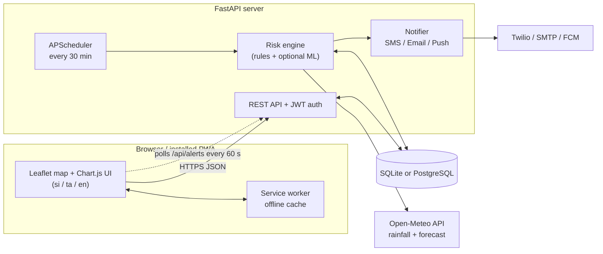

# Architecture



## Data flow (one refresh cycle)
1. The scheduler (or an admin pressing **Refresh**) calls `services.refresh_all`.
2. One bulk request to Open-Meteo returns the last 72 h of rain and the next 24 h forecast for all 25 districts. If it fails, mock values are used and the reading is tagged `source = mock`.
3. For each area the risk engine computes a 0-100 score and a level.
4. A `weather_readings` row is stored (powers the charts) and the area is updated.
5. If the level **rose** to Medium or above, one `alerts` row is created and every subscriber is notified once, in their language.
6. Browsers polling `/api/alerts?since_id=...` show a toast and, if permitted, a browser notification.

## Risk score

```
effective_rain = rain_72h + 0.5 * forecast_24h
score = 100 * ( 0.40 * clamp(effective_rain / 300 mm)
              + 0.30 * river_level        (falls back to the rain signal: no gauge feed yet)
              + 0.20 * clamp(verified_reports_48h / 5)
              + 0.10 * terrain_risk )
Low < 25 <= Medium < 50 <= High < 75 <= Critical
```

The weights are a transparent starting point. The optional ML model (`ml/train.py`) outputs a flood probability that is
shown next to the rule score. With `USE_ML_BLEND=1` it is averaged into the score.

## Community reports
- A login is required to report (accountability, rate limit of 5 reports/hour/user).
- Photos are validated by **magic bytes** (JPEG/PNG/WebP), max 5 MB, and stored under a random filename.
- **Auto-verification:** when 3 *different* users report the same type in the same area within 6 hours, all of them become `verified`. One user repeating a report never self-verifies.
- Admins can verify or reject manually. Only verified reports are public and only verified reports raise the risk score.

## Security measures
| Concern | Measure |
|---|---|
| Passwords | PBKDF2-HMAC-SHA256, 200k iterations, per-user salt, constant-time compare |
| Sessions | Signed JWT (HS256), 24 h expiry, secret generated per install (or `SECRET_KEY`) |
| Privilege escalation | `role` is never read from client input; admin routes use `require_admin` |
| Uploads | Magic-byte check, size cap, random file names, served as static files only |
| XSS | Every server/user string is escaped before `innerHTML` (covered by an automated browser test) |
| Spam | Per-user report rate limit, subscription cap (10), auto-verify needs distinct users |
| Input | Pydantic validation, coordinates restricted to Sri Lanka's bounding box |

## Known limitations (be upfront about these in your report/demo)
- **No live river-gauge data.** Sri Lanka has no public real-time gauge API, so the river term falls back to rainfall. The `river_level` column is ready for a feed or manual entries.
- **Terrain risk values are illustrative estimates**, not NBRO/DMC hazard data. Replace them for real use.
- **Areas are district points/circles**, not true boundaries. Load real polygons (GeoJSON) for production.
- **The ML model is a demo trained on synthetic data** - it shows the pipeline, not real predictive skill. Train it with `python ml/train.py --csv history.csv` on real incident records.
- **Safe zones are sample placeholders** (`is_sample = true`) until replaced with official data.
- **SMS/e-mail contacts are not verified** (no OTP). Add verification before enabling real SMS, otherwise users can subscribe other people's numbers.
- Sinhala/Tamil wording should be reviewed by native speakers or DMC.
- The scheduler runs inside the app process: run **one** worker (as the Dockerfile does).
- This is an advisory/community tool. It does not replace official warnings from the Disaster Management Centre (117).
