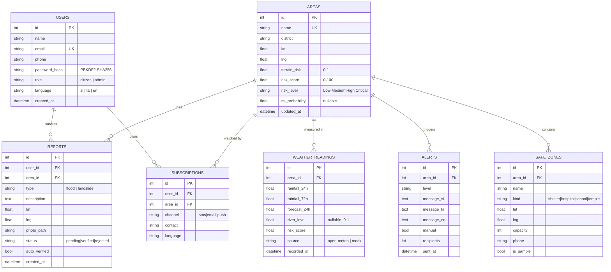

# Database design (ER diagram)

Render with any Mermaid viewer (GitHub, VS Code "Markdown Preview Mermaid", https://mermaid.live).

## Notes
- `SUBSCRIPTIONS` has a unique constraint on `(user_id, area_id, contact, channel)`: every account manages only its own rows.
- `WEATHER_READINGS` older than 30 days are pruned on every refresh.
- `ALERTS` stores the message in all three languages, so each subscriber receives it in their own language.
- `SAFE_ZONES.is_sample = true` marks placeholder rows seeded for the demo. Replace them with official DMC shelter data.
- Moving to PostgreSQL + PostGIS later: replace `lat`/`lng` with a `geometry(Point, 4326)` column and add a `geometry(MultiPolygon)` boundary column on `AREAS`.
